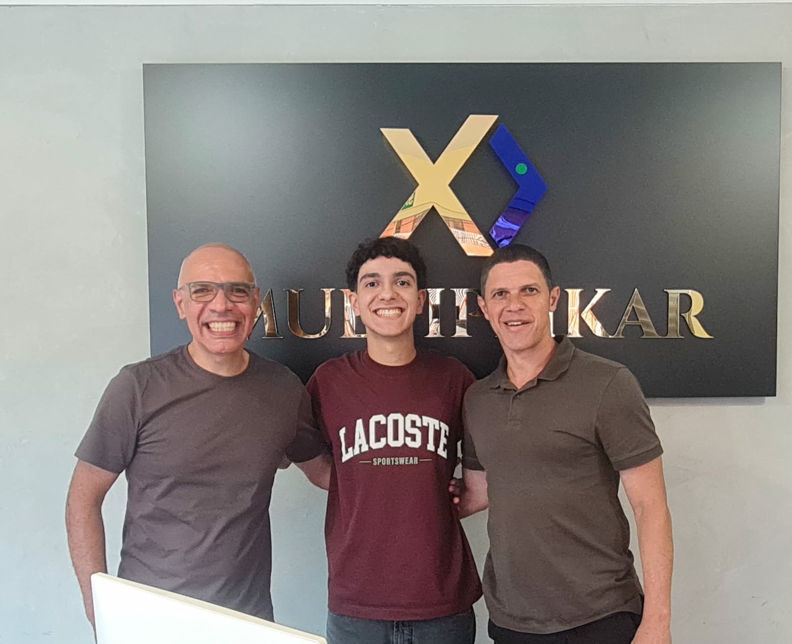
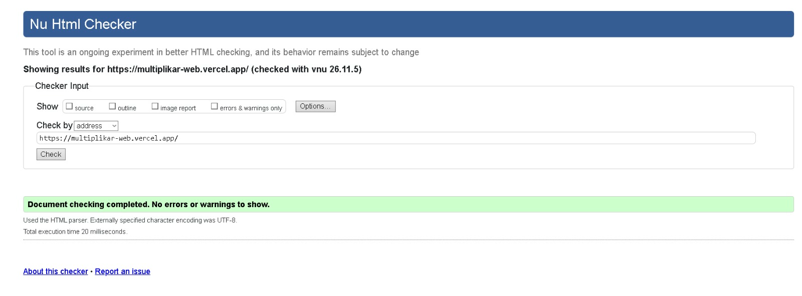
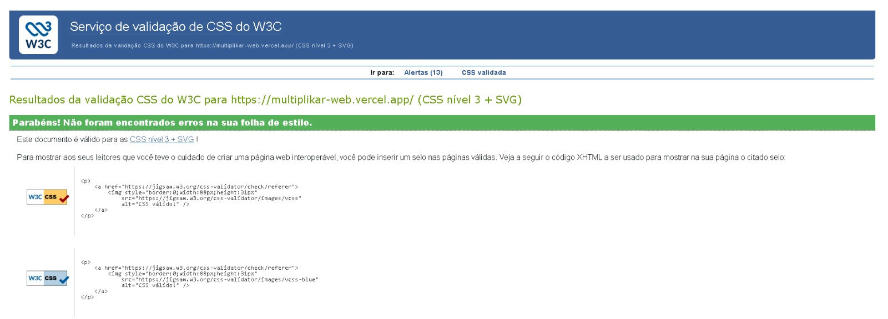
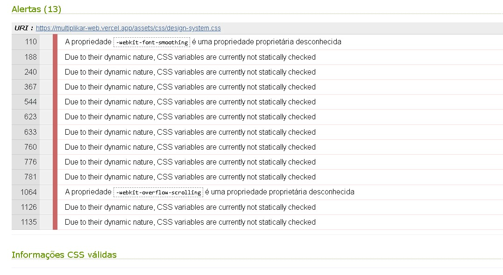

# Multiplikar Automóveis — Entrega 2

**Disciplina:** Desenvolvimento Frontend para Web — A2, 2026.2  
**Professor:** Cid Andrade  
**Integrantes:** Andrey Azevedo Veloso e Brenno Lima do Vale

**Site publicado:** https://multiplikar-web.vercel.app/  
**Repositório:** https://github.com/brennovale/Multiplikar_website

## Introdução

O projeto apresenta a Multiplikar Automóveis, revenda de veículos novos, seminovos e usados localizada na Vila São Geraldo. O site reúne informações sobre compra, venda, troca, consignação, avaliação, financiamento e atendimento pós-venda. Seu objetivo é facilitar a consulta aos serviços e o contato com a loja por meio de páginas interligadas e formulários de atendimento.

## Sobre a organização

A Multiplikar Automóveis é uma empresa estabelecida no ramo automotivo, com sede localizada no bairro Vila São Geraldo. A empresa possui aproximadamente dois anos de atuação no mercado e conta com uma equipe formada por cerca de seis funcionários responsáveis pela condução das operações comerciais, vistorias técnicas e atendimento ao público.

As principais atividades operacionais da empresa compreendem:

- Venda de veículos novos, seminovos e usados;
- Compra de veículos de pessoas físicas;
- Veículos em consignação;
- Avaliação de veículos;
- Análise de laudos cautelares;
- Controle de estoque;
- Vendas à vista e financiadas;
- Pagamentos;
- Garantia;
- Indicações e comissões.

## Contato com a organização

O contato inicial e a articulação institucional com a Multiplikar Automóveis foram realizados por meio do integrante do grupo Brenno Lima do Vale, que atua profissionalmente na organização. Aproveitando esse vínculo direto, Brenno intermediou uma breve reunião com o proprietário da empresa.

Durante o encontro, o proprietário autorizou expressamente o grupo a desenvolver a atividade acadêmica tendo a Multiplikar Automóveis como objeto de estudo, prestando esclarecimentos fundamentais a respeito das rotinas operacionais, fluxo de compra e venda de automóveis, critérios de avaliação cautelar e parcerias bancárias vigentes.

Dados do registro da reunião:

- **Forma de contato:** Reunião presencial;
- **Data da reunião:** 28/09/2026;
- **Nome do proprietário entrevistado:** Regis Umbelino;
- **Local da reunião:** Multiplikar Automóveis, bairro Vila São Geraldo;

 ### Registro fotográfico da visita

A fotografia abaixo registra a visita presencial à Multiplikar Automóveis, realizada como parte das atividades de levantamento de informações para o projeto acadêmico.




## Desenvolvimento

A estrutura HTML da Entrega 1 foi ampliada com uma identidade visual compartilhada em CSS e comportamentos em JavaScript. O levantamento da organização orientou a divisão do conteúdo em dez páginas principais, além de um painel demonstrativo de integração com dados.

| Página | Conteúdo |
|---|---|
| `index.html` | Apresentação da loja, vitrine, serviços, áudio e vídeo |
| `pages/contato.html` | Canais de atendimento, localização e formulário de contato |
| `pages/orcamento.html` | Solicitação de proposta para comprar, vender ou trocar |
| `pages/estoque.html` | Catálogo de veículos e tabela de características |
| `pages/compra-veiculos.html` | Critérios para aquisição de veículos de clientes |
| `pages/consignacao.html` | Processo de intermediação e condições de consignação |
| `pages/avaliacao.html` | Avaliação técnica e análise de laudo cautelar |
| `pages/vendas.html` | Processo comercial e formas de pagamento |
| `pages/financiamento.html` | Instituições parceiras e exemplos de financiamento |
| `pages/garantia.html` | Política informada pela empresa e atendimento pós-venda |
| `pages/sistema.html` | Painel complementar de integração com o banco de dados |

As páginas utilizam `header`, `nav`, `main`, `section`, `article` e `footer`, com um título principal por página. As tabelas possuem cabeçalhos e legendas; os formulários associam rótulos aos campos e usam validação nativa com `required`, `pattern` e tipos específicos. Os ícones SVG acompanham a cor do componente. Áudio e vídeo estão armazenados em `assets/`.

### Pesquisa de layout e identidade visual

Foram reunidas dez referências do setor automotivo, com registro de fontes, características e medições em [design-system/sites.md](design-system/sites.md). A busca de veículos, a fotografia do estoque, a navegação por serviços e as chamadas para contato orientaram a composição do site. O azul foi adotado para ações e links; o verde destaca contato e negociação. Fontes do sistema reduzem dependências e mantêm a leitura consistente.

O CSS compartilhado está em `assets/css/design-system.css`. Grid organiza a vitrine em uma, duas ou três colunas; Flexbox organiza cabeçalho e componentes. O tema escuro altera as variáveis de cor e salva a preferência com `localStorage`. Os botões de tema e menu respondem ao evento de clique em JavaScript. O menu móvel usa botão nativo, informa seu estado com `aria-expanded` e pode ser aberto por teclado.

Os testes de aparência compararam tema claro e escuro, tamanhos do cabeçalho e disposição dos cards em diferentes larguras. Em telas de até 340 px, a logo usa 52 px de altura para se alinhar ao controle de tema. Tabelas largas usam rolagem interna para preservar a leitura sem ampliar a página. A [revisão responsiva](docs/revisao-responsiva.md) contém o escopo dos testes e capturas.

O [exemplo de componentes](design-system/exemplo.html) reúne menu, destaque, três cards, formulário e rodapé. Os [tokens comentados](design-system/tokens.css) documentam a paleta, tipografia e espaçamentos dessa demonstração.

### Formulários e integração

O site foi integrado ao banco desenvolvido pelo grupo na disciplina de Modelagem de Dados, também voltado à Multiplikar Automóveis. Essa integração conecta a interface aos dados e processos modelados, permitindo aplicar conjuntamente os conhecimentos das duas disciplinas. Na Entrega 2 de Frontend, o banco constitui um recurso complementar aos requisitos de HTML, CSS e JavaScript. O modelo, os scripts SQL e a documentação acadêmica estão no [repositório de Modelagem de Dados](https://github.com/andreyveloso/modelagem-banco-multiplikar-automoveis).

Contato e orçamento utilizam validação básica do navegador. O JavaScript apresenta o resultado do envio; as funções de `api/` encaminham os dados ao serviço da organização. As configurações de conexão são fornecidas por variáveis de ambiente no servidor. A implementação complementar da API Python e a documentação do banco estão em `servidor/`.

### Uso de inteligência artificial

O modelo informado pelo grupo para o desenvolvimento foi Codex Luna 6, com nível High, utilizado no ambiente Maestri. A IA apoiou a leitura dos materiais da disciplina, a pesquisa de referências, a organização dos documentos e a implementação de CSS e JavaScript. A motivação foi acelerar a comparação de alternativas e a revisão de consistência entre páginas.

As respostas foram conferidas com o briefing, os materiais da disciplina, os valores computados no navegador e os validadores W3C. Valores observados em sites de terceiros são identificados como medições; escolhas próprias da Multiplikar são descritas como decisões do projeto.

Para produzir um resultado equivalente com IA, o processo começa pelo briefing e pelos requisitos da entrega, segue pela pesquisa de sites reais e pela definição dos tokens, e então desenvolve um componente por vez. Cada alteração deve ser confrontada com a referência, validada em HTML/CSS e testada em celular, tablet e desktop antes da publicação.

## Validação e publicação

O site está publicado na Vercel em https://multiplikar-web.vercel.app/. As onze páginas HTML foram validadas, e todas foram revalidadas após a revisão de acessibilidade do menu. O CSS publicado passou no perfil CSS3 + SVG com zero erros; os treze avisos dizem respeito a variáveis CSS e extensões de fornecedor. O [mapa de requisitos](docs/criterios-entrega.md) relaciona os critérios aos arquivos. O [relatório de validação](docs/validacao-w3c.md) apresenta os resultados e os arquivos de evidência.

O domínio próprio escolhido para uma futura aquisição é `multiplikarautomoveis.com.br`, registrado como disponível na consulta apresentada pelo grupo. A pesquisa das alternativas, as capturas e o procedimento de aquisição estão em [domínio e publicação](docs/dominio-e-publicacao.md).

### Validação do HTML



### Validação do CSS



### Avisos da validação



## Estrutura dos arquivos

```text
index.html
pages/          Páginas de conteúdo e formulários
assets/         CSS, JavaScript, imagens, áudio, vídeo e dados
api/            Funções de integração executadas pela Vercel
design-system/  Referências, tokens, exemplo e capturas
docs/           Pesquisa, validação, publicação e evidências
servidor/       API Python e documentação complementar do banco
```

Para navegar localmente pelas páginas estáticas, execute `python -m http.server 8000` na pasta do projeto e abra `http://localhost:8000`. Os formulários integrados dependem das funções da Vercel e da API configurada; o servidor estático não executa essas funções.

## Conclusão

A Entrega 2 relaciona os conteúdos de HTML semântico, CSS e JavaScript a uma organização real. O trabalho mostrou a importância de definir componentes compartilhados, conferir informações com a empresa e testar a interface em larguras pequenas. A revisão das tabelas e do cabeçalho evidenciou que um conteúdo correto também precisa de uma apresentação adequada ao espaço disponível. A documentação das referências e dos validadores torna as decisões e os resultados verificáveis.
